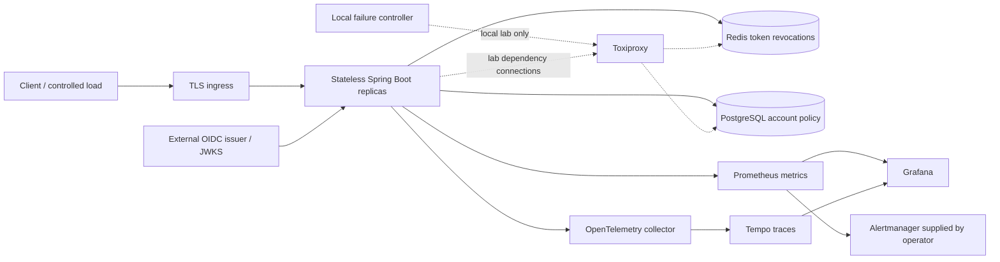
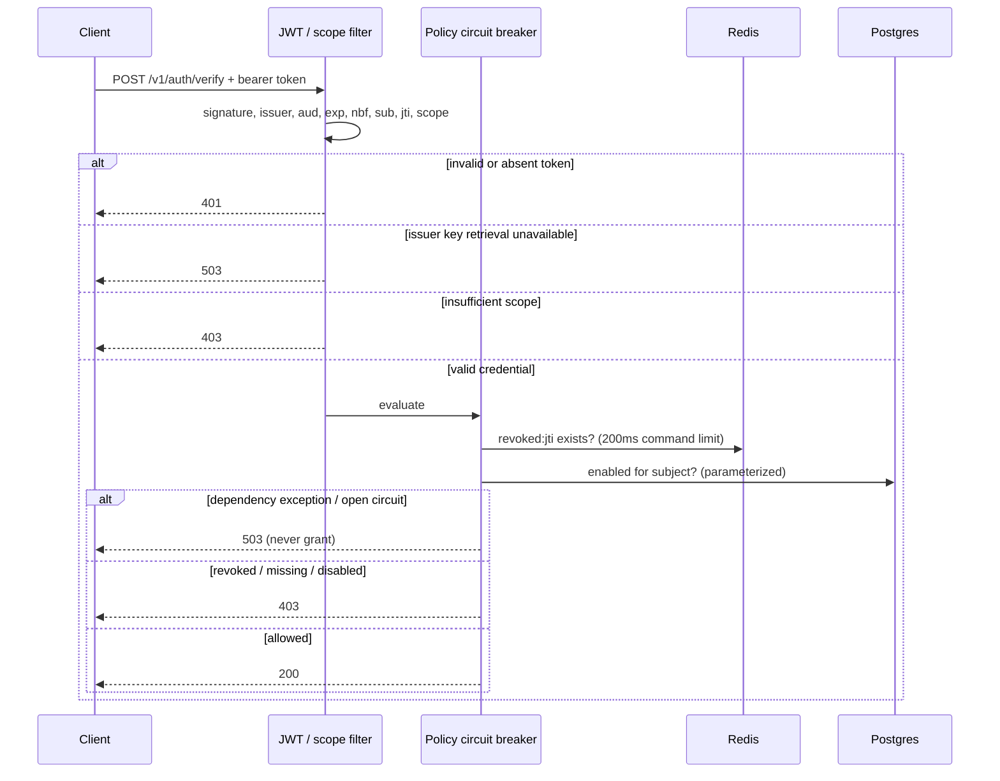

# Architecture and failure boundaries

There is no in-memory session or permissive account cache. Replicas share current revocation and enabled-state data. JWT signing keys are cached by the standard Nimbus decoder; known keys permit validation during brief issuer outages, while unseen keys cannot be validated. Rotating keys requires an overlap period longer than token lifetime and cache behavior validation against your IdP.

The breaker wraps only the Redis/SQL policy read, not invalid credentials. It opens at >=50% failures after at least five calls in a 20-call window, permits two half-open trial calls after five seconds and closes on successful trial calls. Each pod has its own breaker. Legitimate denials count as successful dependency operations. It retries transient data-access exceptions at most once after 25ms, within the breaker; SQL and Redis calls have their own bounded timeouts. No retry for arbitrary runtime exceptions.

Approximate worst-case dependency latency is a few seconds under exhausted pools / two connection attempts, not an end-to-end 300ms guarantee. Thread/connection pools bound concurrency but require capacity planning. Clients and ingress must bound total request deadlines. Readiness removes unhealthy replicas after two failed five-second checks; liveness ignores external dependencies to avoid restart storms. A common database outage can remove every replica from readiness; that is intentional fail-closed behavior and must be paired with a highly available database.

The local lab intentionally has single-instance dependencies and a single app. It demonstrates failure handling and restart recovery, not multi-zone resilience. Kubernetes controls are rendered and linted; real scheduling, HPA, PDB, multi-replica failover and zonal fault behavior require cluster exercises.
